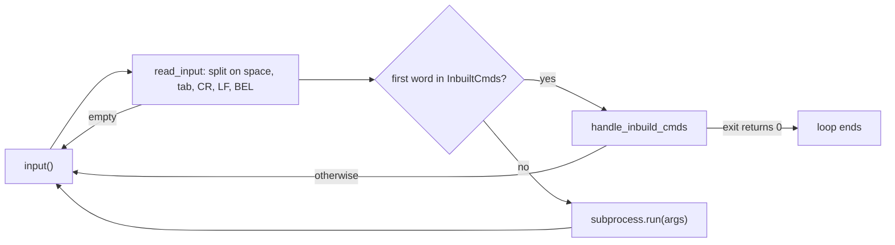

<div align="center">

# 🐍 piss
**piss — Python Interactive Shell System: a small REPL shell written in pure Python.**

[](https://www.python.org/)
[](https://docs.astral.sh/uv/)
[](https://pyinstaller.org/)
[](pyproject.toml)

[What it does](#-what-it-does) · [Quick start](#-quick-start) · [Commands](#-commands) · [Build](#-build-a-standalone-executable) · [Known limitations](#-known-limitations)

</div>

---

## 🐍 What it does

`piss` prints a banner, then reads one line at a time from a `> ` prompt. The line is split on whitespace; if the first word is a built-in (`cd`, `clear`, `exit`, `help`) the shell handles it itself, otherwise it launches the program with `subprocess.run` and waits for it to finish. No shell is involved in that call, so the first word must be a real executable on your `PATH`.

> [!WARNING]
> **Ctrl+C at the prompt exits the shell** (no confirmation). **Ctrl+D / end of input** crashes with an `EOFError` traceback, and **Ctrl+C while a program is running** crashes with a `KeyboardInterrupt` traceback ([src/main.py:40-43](src/main.py#L40-L43), [src/main.py:73-78](src/main.py#L73-L78)). Type `exit` to leave cleanly.

## ✨ Features

| | |
|---|---|
| 🧩 **Built-ins** | `cd`, `clear`, `exit`, `help`, dispatched through the `InbuiltCmds` enum |
| 🚀 **External commands** | Anything else runs as a child process via `subprocess.run(args)` |
| 🧯 **Error messages** | Unknown programs print `piss: Command not found: <name>` instead of crashing |
| ↩️ **Blank lines ignored** | Empty or whitespace-only input re-prompts |
| 📦 **Zero runtime deps** | Standard library only (`re`, `os`, `subprocess`, `enum`) |
| 🪟 **Single-file binary** | `main.spec` bundles it into one console executable with PyInstaller |

## 🏗️ How a line is processed



## ⚡ Quick start

1. **Prerequisites:** [uv](https://docs.astral.sh/uv/). It picks up Python 3.12 from [.python-version](.python-version).

   > [!NOTE]
   > Python 3.12+ is required (`requires-python = ">=3.12"`). The `args[0] in InbuiltCmds` check relies on string-in-enum membership, which raises `TypeError` on 3.11.

2. **Clone and install** (`uv sync` only installs the PyInstaller dev dependency):

   ```bash
   git clone https://github.com/Avi-Rana-1718/piss.git
   cd piss
   uv sync
   ```

3. **Run:**

   ```bash
   uv run python src/main.py
   ```

4. **Check it works:**

   ```text
    piss v1.0 — Python Interactive Shell System

   ~~~~~~~~~~~~~~~~~~~~~~(:>  sssss
   > whoami
   yourmachine\you
   > exit
   ```

## 📖 Commands

<details open>
<summary><b>Built-ins</b></summary>

| Command | Behavior |
|---|---|
| `cd <dir>` | `os.chdir(dir)`. Errors, including a missing argument, print as `piss: <error>` |
| `clear` | Sends the ANSI clear-screen sequence `ESC[H ESC[2J` |
| `help` | Prints `piss help` (placeholder, no command list yet) |
| `exit` | Leaves the loop |

</details>

<details>
<summary><b>External programs</b></summary>

Any other first word is run as `subprocess.run([cmd, *args])`:

```text
> git status
> python --version
> nonexistent
piss: Command not found: nonexistent
```

The exit code of the child process is ignored.

</details>

## 🧱 Build a standalone executable

```bash
uv run pyinstaller main.spec
# output: dist/main.exe on Windows (dist/main elsewhere), a single-file console app
```

`build/` and `dist/` are ignored by [.gitignore](.gitignore).

## 🚧 Known limitations

| Limitation | Cause |
|---|---|
| Ctrl+D crashes | `EOFError` from `input()` is not caught |
| Ctrl+C during a running program crashes the shell | `KeyboardInterrupt` from `subprocess.run` is not caught (it subclasses `BaseException`, so `except Exception` misses it) |
| Ctrl+C at the prompt exits instead of clearing the line | The `KeyboardInterrupt` handler around `input()` does `break` |
| No quoting, pipes, redirects, globs, or env vars | Input is split with a regex on whitespace and passed directly to `subprocess.run` |
| `cmd.exe` built-ins (`dir`, `cls`, `type`, ...) not found on plain Windows | No shell is spawned; they only work if a same-named executable is on `PATH` (Git for Windows ships some) |

## 🗂️ Project structure

```text
.
├── src/main.py        # the whole shell: banner, REPL loop, parser, built-ins
├── main.spec          # PyInstaller build config (one-file, console, exe name "main")
├── pyproject.toml     # project metadata; dev dependency: pyinstaller>=6.22.3
├── uv.lock            # locked dependency versions
└── .python-version    # 3.12
```

## 🛠️ Development

No tests, linter, formatter, or CI are configured yet.

```bash
uv sync                          # install dev deps
uv run python src/main.py        # run from source
uv run pyinstaller main.spec     # build dist/main(.exe)
```
